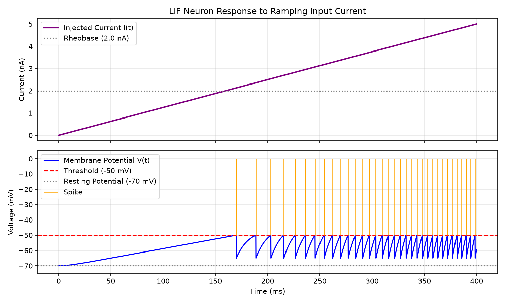

# LIF Neuron Simulator

A from-scratch implementation of the Leaky Integrate-and-Fire (LIF) neuron model in Python, built as a first step into computational neuroscience. I come from a computer engineering background, so the goal of this project is to learn the biology behind the model while writing and validating the code myself.

## Question

> How does the firing rate of a LIF neuron depend on the input current (and, later, on noise)? Which parts of real neuron behavior does such a simple model capture, and which parts does it miss?

## Background

A neuron keeps a voltage difference across its membrane (about -70 mV at rest, inside relative to outside). When input pushes this voltage up to a threshold (about -50 mV), voltage-gated Na+ channels open and the neuron fires a spike. The LIF model ignores the channel details and treats the membrane as a simple circuit:

- the lipid membrane acts as a **capacitor** (C)
- the ion channels (mostly leak channels) are lumped into one **resistor** (R)

Splitting the injected current between the two, I(t) = I_C(t) + I_R(t), gives

```
tau_m * dV/dt = -(V - V_rest) + R_m * I(t)        tau_m = R_m * C_m
```

This equation alone only charges the membrane toward `V_rest + R*I`. To get spikes, an **integrate-and-fire rule** is added: when V reaches `V_thresh`, a spike is recorded and V is reset to `V_reset`.

Because the steady-state voltage is `V_rest + R*I`, the neuron only fires if `R*I > V_thresh - V_rest`. The smallest current that does this is the **rheobase**:

```
I_rheobase = (V_thresh - V_rest) / R_m = 2 nA   (with the default parameters)
```

My own step-by-step notes (membrane potential, ion gradients, the circuit derivation) are in [`docs/biology_notes.md`](docs/biology_notes.md).

## Model and parameters

| Parameter | Symbol | Default | Unit | Biological meaning |
|---|---|---|---|---|
| Resting potential | `v_rest` | -70 | mV | Balance of pump and leak currents |
| Reset potential | `v_reset` | -65 | mV | Voltage right after a spike |
| Threshold | `v_thresh` | -50 | mV | Where Na+ channels open and the neuron fires |
| Membrane time constant | `tau_m` | 10 | ms | How fast the membrane charges and leaks |
| Membrane resistance | `r_m` | 10 | MOhm | Combined effect of the leak channels |

Units are consistent: MOhm x nA = mV, and time is in ms.

Numerical method: forward Euler with a fixed time step `dt`.

## Repository structure

```text
lif-neuron-simulator/
├── README.md
├── pyproject.toml
├── src/
│   └── lif/
│       ├── __init__.py
│       └── model.py              # LIFNeuron class and Euler simulation loop
├── tests/
│   └── test_model.py             # Analytical validation tests
├── notebooks/
│   └── 01_single_neuron.ipynb    # Subthreshold and ramp current exploration
├── figures/
│   └── ramp_response.png         # Generated plots for documentation
└── docs/
    └── biology_notes.md          # Study notes on neurophysiology & RC derivation
```

## Usage

```python
import numpy as np
from lif.model import LIFNeuron

neuron = LIFNeuron(v_rest=-70.0, v_reset=-65.0, v_thresh=-50.0, tau_m=10.0, r_m=10.0)

dt = 0.1                                  # ms
t = np.arange(0, 400.0, dt)
i_inj = np.linspace(0.0, 5.0, len(t))     # ramping current, nA

v, spikes = neuron.simulate(i_inj, dt)    # v in mV, spike times in ms
print(len(spikes), "spikes")
```

### Example: ramp input

A slowly increasing current is a simple way to see the rheobase in action: the neuron stays silent while `R*I` is below the threshold gap, then starts firing, and the spikes get closer together as the current grows.



*(Figure generated by the plotting script/notebook; the voltage trace is held at threshold for the spike moment, so spike shape is not modeled, only spike timing.)*

## Validation

Tests live in `tests/` and compare the simulation against known analytical results:

1. **Subthreshold response.** With a constant current that never reaches threshold, the voltage follows `V(t) = V_rest + R*I*(1 - exp(-t/tau_m))`. The simulated trace is checked against this curve and no spikes are expected.
2. **Rheobase.** No spikes below `(V_thresh - V_rest)/R_m`, spikes above it.
3. **Inter-spike interval (ISI).** For a constant suprathreshold current the exact ISI is

   ```
   T = tau_m * ln( (R*I - (V_reset - V_rest)) / (R*I - (V_thresh - V_rest)) )
   ```

   and the mean simulated ISI is compared to it.

Run them with:

```bash
pytest
```

## Installation

```bash
git clone https://github.com/nisaklsoglu/lif-neuron-simulator.git
cd lif-neuron-simulator
python -m venv .venv && source .venv/bin/activate
pip install -e . pytest
```

Requires Python 3.9+, NumPy and Matplotlib.

## Limitations

This is a deliberately simple model. It does **not** capture:

- the actual shape of the spike (the rise to about +30 mV and the dip below rest); only spike times are kept
- ion channel dynamics (Na+ inactivation, voltage-gated K+ channels); for that the Hodgkin-Huxley model is needed
- spike-frequency adaptation and the afterhyperpolarization after a spike
- any refractory behavior, which is not implemented yet

Numerical notes: spikes are detected at the step after the threshold is crossed, so spike times can be late by up to one `dt`. Forward Euler is first-order, so accuracy depends on `dt`.

## Roadmap

- [x] LIF model with Euler integration and threshold/reset rule
- [x] Analytical subthreshold test, plotting of ramp input
- [ ] Absolute refractory period
- [ ] f-I curve (firing rate vs. input current) compared with the closed-form formula
- [ ] `dt` convergence analysis (error vs. time step)
- [ ] Noisy input: ISI histogram and coefficient of variation (CV)
- [ ] Cross-check against Brian2

What the LIF model cannot explain (spike shape, adaptation) points to the next hypotheses to test: adaptive LIF or Hodgkin-Huxley.

## References

- Gerstner, Kistler, Naud, Paninski. *Neuronal Dynamics* (free online: neuronaldynamics.epfl.ch)
- Neuromatch Academy, Computational Neuroscience course (biological neuron models tutorials)
- Dayan and Abbott. *Theoretical Neuroscience*